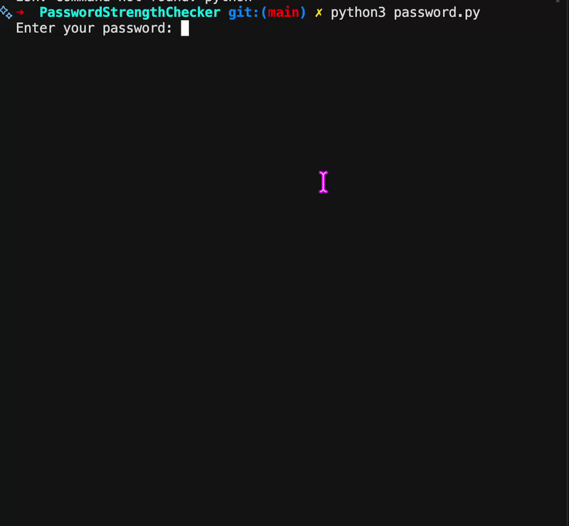
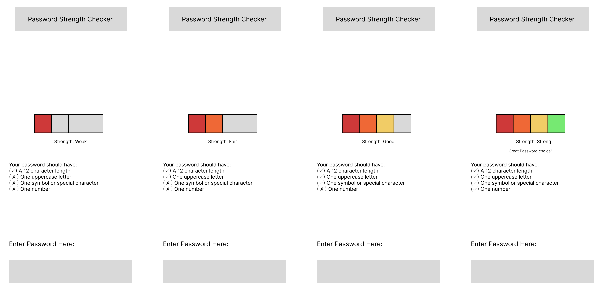

# Password Strength Checker


This is a Python program that not only checks the strength of a password but also lets you know what else you need to make it stronger!

[Try it live](https://danika-passwordstrengthchecker.streamlit.app)

## Why I Built This

I built this to jump back into Python and explore coding keeping the user in mind, which is why I started by sketching in Figma.

## Features

- Checks 4 rules: 12+ characters, an uppercase letter, a special character, and a number
- Rates your password as Weak, Fair, Good, or Strong
- Shows a checklist so you know exactly what to fix
- Colored strength bar that fills up from red to green
- Hides your password as you type
- Works as a web app or in the terminal

## Demo


```
Enter your password: Glinda
Strength: Weak
Your password should have:
(x) At least 12 characters
(✓) One uppercase letter
(x) One symbol or special character
(x) One number
```

## Design Process

I really wanted to first try and sketch what a user might see using this application. I tried to keep the colors of the strengths very familiar and keep text at a minimum to avoid confusion. 



Choices I made:

- Password box at the bottom: I placed the text box near the bottom of the screen so it’s easy to reach with your thumb and sits right above the keyboard.
- Red to green strength bar: It was a familiar set up compared to traffic lights. 
- ✓ and x checklist: This was to show user what they can do to make their password stronger.

## Design Decisions

- Spaces count as special characters: Many websites and security guidelines count spaces as special characters, since long passphrases with spaces can be very strong
- Empty passwords: I made it so if a user does not enter a password, an error message gets sent out that tells them to enter a valid one! 
- Readable colors: The strength text uses green for Good instead of yellow, since yellow text is hard to read on a white background.
- Hidden input: The password box hides what you type, just like a real login screen.

## How to Run

Make sure Python 3 is installed, then run:

```
python3 password.py
```

To run the web version, set up a virtual environment and install the requirements:

```
python3 -m venv .venv
source .venv/bin/activate
pip install -r requirements.txt
streamlit run app.py
```

## Project Structure

- `password.py`: the password checking logic, plus the terminal version
- `app.py`: the Streamlit web app, which reuses the checks from password.py
- `wireframe.png`: my Figma wireframe

## What I Learned

- Using loops to check each character in a string
- Using True/False variables to keep track of what I found
- Using if / elif / else to choose between options
- Input validation (checking input before using it)
- Designing in Figma before coding (this helped shape my code a lot!)
- Using Git and GitHub to save my progress
- Writing functions that return values so I can reuse my code in another file
- Building a web app with Streamlit
- Using a virtual environment to keep my project's packages separate
- A little HTML to build the colored strength bar

---

Built by Danika Mohan 
· [GitHub](https://github.com/danikamohan) 
· [LinkedIn](https://linkedin.com/in/danimohan)